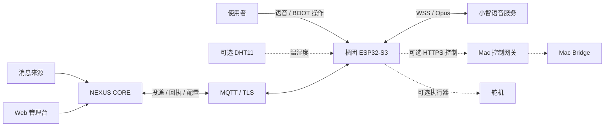

# 24 · 栖团 Qitomo 项目介绍

栖团 Qitomo 是基于 ESP32-S3 的实体 AI 桌面伙伴，把语音交流、消息接收、环境感知和宠物成长放在同一块小屏幕中。它面向个人桌面使用，也为嵌入式开发者提供一个可以逐层理解、验证和扩展的工程。

本文介绍产品定位与当前系统，不替代[需求台账](18-requirements-and-progress.md)的完成度记录。更新：2026-11-13；设备版本 `0.4.0-dev`，CORE `0.1.0-SNAPSHOT`，均为开发版本。

## 为什么做这个项目

语音助手负责交流，通知工具负责传递信息，电子宠物负责互动。栖团尝试把这些体验放到一个有持续状态的角色上：消息有卡片与回执，对话有文字与表情，照料和专注有成长反馈，环境变化也会反映在角色表现中。

实体屏幕让这些信息拥有固定的桌面位置。运行职责由 ESP32 与常在线服务承担，Mac 主要用于开发；可选电脑控制按需要接入。

“陪伴”是产品体验目标；当前数值、表情和行为来自明确的成长规则与状态机，不宣称已经实现情绪理解、人格记忆或自主智能体。

## 适合的使用场景

| 场景 | 交互方式 | 当前实现与依赖 |
| --- | --- | --- |
| 工作间隙交流 | 唤醒或按住说话，查看回复文字与角色表情 | 设备侧链路已实现，需显式启用、小智凭据及真实语音验收 |
| 接收桌面消息 | 屏幕展示卡片，操作后记录展示/已读回执 | CORE、MQTT/TLS 与设备软件已有隔离联调；真实投递待验收 |
| 轻量照料与专注 | 喂食、摸头、玩耍、每日任务、专注奖励 | 成长规则和本地演练可用；持续实机体验待验收 |
| 感知桌面环境 | 查看温湿度和趋势，观察冷/热/干/湿表现 | 可选 DHT11 扩展，默认关闭；采样与联动软件已实现，实机待验收 |
| 扩展桌面交互 | 查询 Mac 状态、确认打开白名单应用，或控制舵机 | 可选能力默认关闭；需各自部署、供电、校准与现场验收 |

## 一个角色，四种日常能力

**交流。** 固件包含本地唤醒/VAD、半双工音频、WSS/Opus 与对话状态机。文字、表情和口型由设备表现层消费。普通 AI 会话仍为半双工；并行 I/O 诊断的实现不等于声学全双工或播放中打断已经通过验收。见[语音设计](01-ai-agent.md)和[音频诊断边界](22-audio-duplex-diagnostic.md)。

**收件。** 消息中心负责校验、优先级队列、持久化、去重与回执，屏幕负责卡片展示。免打扰和 critical 消息按既有策略处理；管理台已有测试发送和状态筛选，完整规划的来源/设备/时间筛选、导出等仍有缺项。见[消息中心](02-message-hub.md)和[管理台完成度](23-console-completion.md)。

**成长。** 角色有饥饿、心情、精力、健康、亲密等数值，以及八种状态动画、每日任务和一次性成就。照料、成功对话与专注可以触发相应奖励。设备存档由设备拥有，CORE 只读展示上传的成长镜像；两端奖励尚未统一下发或合并。见[成长设计](04-growth-game.md)和[跨端镜像](21-growth-sync.md)。

**感知。** 温湿度采样、60 分钟趋势、告警与成长联动已有实现。冷/热/干/湿只在相应角色状态上叠加，过期或失效读数不继续参与环境结算。见[温湿度设计](03-climate-sensor.md)。

## 系统怎样组成

ESP32 负责屏幕、输入、传感器、成长存档、设备端消息与语音会话；小智负责云端语音能力。CORE 常驻 Linux，负责消息、设备管理、配置与审计，音频不经 CORE。

可选公开记忆工具由 CORE MCP 和 stdio 桥接提供，用于受授权的公开资料检索。它需要独立凭据和供应商工具采用；当前本地回环证据不能代表真实供应商已经接入。见[记忆工具](16-voice-memory-tools.md)与[桥接验证](17-voice-bridge-regression.md)。

设备的离线成长与联网功能有独立边界：断网不会把本地玩法变成 Mac 依赖；语音对话、远程收件与远程配置仍需要各自的在线服务。自建 `server/ai-gateway/` 仅为预留。

## 工程中值得保留的结构

| 结构 | 作用 | 当前源码入口 |
| --- | --- | --- |
| 单独的应用组合根 | 启动、配置与事件接线有统一入口 | [app.c](../firmware/main/app/app.c) |
| 版本化契约与事件 | 让模块、设备和服务端有明确的数据边界 | [contracts](../firmware/components/contracts/include/pet/)、[集成契约](../integration/README.md) |
| HAL 与业务分离 | 主机验证复用业务逻辑，硬件驱动单独验收 | [pet_hal](../firmware/components/pet_hal/)、[主机测试](../tests/README.md) |
| 表现与 LVGL 分离 | 状态和动画规则可测试，UI 专注于绘制与输入 | [presentation](../firmware/components/presentation/)、[角色图元](../firmware/components/ui_lvgl/src/pet_avatar.c) |
| 板型配置单一来源 | 引脚由 board.json 生成，减少多处维护 | [board.json](../firmware/boards/dodo-s3-lcd/board.json) |
| 独立扩展和仓库边界 | 控制、舵机、CORE 与 Bridge 各自维护 | [扩展](../extensions/README.md)、[CORE 集成](../integration/README.md) |

这些结构支持的工程取舍是：先用主机、契约和真实渲染缩短反馈，再用硬件与生产环境验证其不可替代的部分。主机存储替身不证明 Flash 掉电可靠，构建成功不证明真实声音可用，隔离服务联调也不证明生产部署完成。

## 当前阶段与下一步

已交付的软件覆盖设备核心模块、管理与维护、OTA 事务、公开记忆桥接及成长只读镜像。详细命令、历史版本和远程 CI 分别记录在[任务台账](18-requirements-and-progress.md)、各功能文档和[部署记录](../deployment/README.md)。本文不重新认证历史测试。

剩余产品验收集中在：

1. 真实云端、Broker ACL、供应商工具采用及常在线服务器部署。
2. 实机屏幕、输入、录放音、传感器、断网和 NVS 掉电恢复。
3. 生产签名与 HTTPS、OTA 回滚、舵机供电及机械限位。
4. 语音延迟、声学打断和 24 小时 / 7 天稳定性。

首版范围不包含本地大模型、任意 shell、多设备集群、自动旧 NVS 迁移或舵机闭环反馈。资源管线、多语言、其他控制平台及跨端奖励下发保留为后续范围。

想先体验软件，从[本地上手](26-getting-started.md)开始；需要接入设备或服务时，再按[产品验收标准](07-roadmap-acceptance.md)和对应部署、维护文档推进。
