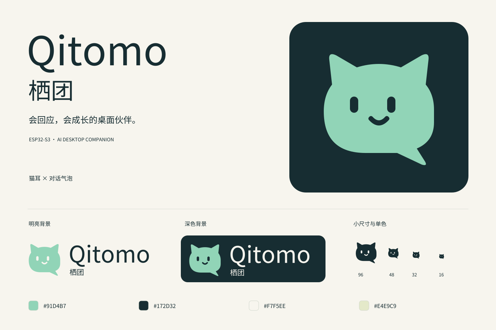

# 25 · 栖团 Qitomo 品牌说明

## 名称与定位

产品中文名为 **栖团**，英文识别名为 **Qitomo**，首次介绍写作“栖团 Qitomo”。一句话定位：**会回应、会成长的桌面伙伴。**

“栖”读 qī，表达在桌面安居、长久相伴；“团”呼应圆润的猫形角色，也让名字带一点可呼唤的亲近感。Qitomo 是为本项目选用的英文识别名，起音取自“栖”，建议按 `qi-to-mo` 三个音节读；它不代表某项技术缩写。

名称围绕用户与角色的关系，而具体硬件、服务和协议继续使用其准确名称。这样既能介绍一款完整的桌面伙伴，也方便在技术文档里定位实现。

## Logo 设计

标志将**猫耳与对话气泡**合为一个连续轮廓：猫耳承接现有固件中的猫形宠物，圆润主体表达陪伴，右下气泡尾部对应语音与消息。两枚竖向圆角眼睛和一条微笑构成表情；面部为镂空，可直接适配单色印刷。

薄荷绿取自当前角色的 `MINT 0x91D4B7`，墨绿取自 `INK 0x172D32`，出处为 [pet_avatar.c](../firmware/components/ui_lvgl/src/pet_avatar.c)。暖白用于文档背景。主体不叠加芯片、Wi-Fi、麦克风、爪印等小图案，确保缩小后仍可辨认。

标志是对现有角色的品牌提炼；交付的介绍图和图标不是固件界面截图，当前屏幕角色仍由原有 LVGL 图元绘制。

## 颜色与字标

| 名称 | 色值 | 用途 |
| --- | --- | --- |
| 薄荷绿 Mint | `#91D4B7` | 主标志、浅色背景上的角色识别 |
| 墨绿 Ink | `#172D32` | 字标、图标底色、浅色背景上的单色标志 |
| 暖白 Paper | `#F7F5EE` | 展示背景、深色背景上的字标 |
| 浅米 Cream | `#E4E9C9` | 延续现有角色的辅助配色 |

正式横向 Logo 使用 Noto Sans SC Regular 的字形轮廓，包含“栖团”和“Qitomo”。SVG 中字形已转为路径，不依赖阅读者安装字体。字体沿用项目已有的 SIL OFL 1.1 授权，来源与许可见[字体说明](../resources/fonts/README.md)和 [OFL](../resources/fonts/OFL.txt)。

## 资产选择

| 场景 | 资源 |
| --- | --- |
| README、白色或暖白背景 | [横向 Logo](assets/brand/qitomo-logo.svg) |
| 深色页面、演示封面 | [反白横向 Logo](assets/brand/qitomo-logo-dark.svg) |
| 独立图形、头像中的主体 | [薄荷绿符号](assets/brand/qitomo-symbol.svg) |
| 单色印刷、雕刻 | [墨色符号](assets/brand/qitomo-symbol-ink.svg)、[白色符号](assets/brand/qitomo-symbol-white.svg) |
| 方形图标 | [SVG 图标](assets/brand/qitomo-icon.svg)、[1024 PNG](assets/brand/qitomo-icon-1024.png)、[256 PNG](assets/brand/qitomo-icon-256.png)、[64 PNG](assets/brand/qitomo-icon-64.png) |
| 项目介绍与分享 | [品牌展示图](assets/brand/qitomo-brandboard.png) |

完整目录、尺寸、来源与导出命令见[品牌资产说明](assets/brand/README.md)。正式资产使用 SVG 原稿生成；PNG 保留透明通道，图标自带墨绿圆角底。

## 使用规则

- 保持原始比例和猫耳、气泡尾部的完整轮廓；四周至少保留图形可见高度的 1/8 空间。
- 独立符号建议不小于 24 px；16 px 时改用附带的简化小尺寸符号。横向 Logo 建议显示宽度至少 220 px，空间不足时使用独立符号。
- 浅色背景使用标准横向版；深色背景使用反白版。薄荷绿不用于暖白背景上的小号正文。
- 使用单色版进行雕刻、丝印或黑白输出；保留面部镂空，不额外增加渐变、描边和阴影。
- 品牌 Logo 用于项目介绍与身份识别，设备的静音、免打扰、故障和危险动作仍使用准确的原有状态与提示。

## 与现有技术名称的关系

| 名称 | 含义与使用位置 |
| --- | --- |
| 栖团 Qitomo | 面向用户的产品名、文档标题与品牌资产 |
| `04-ai-desktop-pet` / `ai-desktop-pet` | 本地工程目录与当前 Git 仓库 |
| `nexus_pet` / `NEXUS PET` | 现有构建产物、固件与工具界面中的技术标识 |
| `nexus-core` / NEXUS CORE | 独立的消息与设备管理服务 |
| `dodo-s3-lcd` / DODO | 当前板型及 donor 工程语境 |
| 小智 / “小爱同学” | 当前语音服务与已选模型唤醒词 |

本次将新名称落在项目介绍与品牌资源中。固件显示名、唤醒词、MQTT 主题、NVS 命名空间、协议、构建产物和其他仓库继续沿用现有标识；界面更名需后续单独检查字库、布局、构建身份与兼容性。
