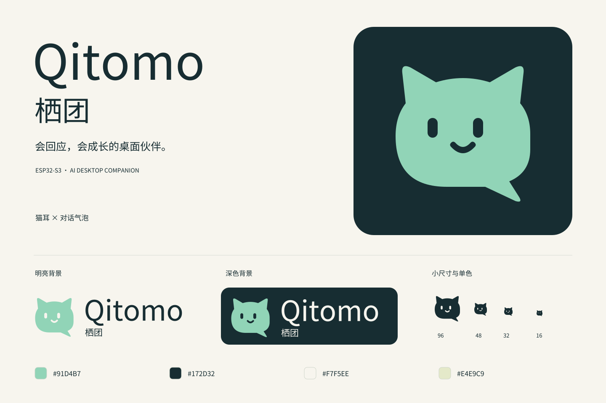

# 栖团 Qitomo 品牌资产



## 文件与用途

| 文件 | 尺寸 / 格式 | 用途 |
| --- | --- | --- |
| [qitomo-logo.svg](qitomo-logo.svg) | 640×200，透明 SVG | 浅色背景横向中英 Logo |
| [qitomo-logo-dark.svg](qitomo-logo-dark.svg) | 640×200，透明 SVG | 深色背景，暖白字标 |
| [qitomo-symbol.svg](qitomo-symbol.svg) | 512×512，透明 SVG | 薄荷绿独立标志 |
| [qitomo-symbol-ink.svg](qitomo-symbol-ink.svg) | 512×512，透明 SVG | 墨色单色版 |
| [qitomo-symbol-white.svg](qitomo-symbol-white.svg) | 512×512，透明 SVG | 暖白单色版 |
| [qitomo-symbol-small.svg](qitomo-symbol-small.svg) | 可缩放 SVG，名义 24×24 | 16–23 px 小图标，省略微笑并收紧画布 |
| [qitomo-icon.svg](qitomo-icon.svg) | 512×512 SVG | 墨绿圆角底的方形图标原稿 |
| [1024 PNG](qitomo-icon-1024.png) / [256 PNG](qitomo-icon-256.png) / [64 PNG](qitomo-icon-64.png) | RGBA PNG | 分享、头像与图标，圆角外透明 |
| [qitomo-brandboard.svg](qitomo-brandboard.svg) / [PNG](qitomo-brandboard.png) | 1440×960 | 名称、标志、浅深背景、小尺寸和配色展示 |
| [render.mjs](render.mjs) | Node.js 导出脚本 | 从已入库 SVG 重导出四份 PNG |

SVG 是可编辑原稿，所有字形已转为路径，没有远程链接、外部字体、脚本或位图嵌入。展示图是品牌设计稿，不能作为实机或管理台截图使用。

## 来源

- 图形：本项目为栖团原创绘制，轮廓融合猫耳与对话气泡；配色承接现有 [LVGL 角色](../../../firmware/components/ui_lvgl/src/pet_avatar.c)。
- 字形：项目已使用的 Noto Sans SC Regular，来自 LVGL v9.5.0 测试资源；原字体 SHA-256 与来源 URL 见[字体清单](../../../resources/fonts/manifest.json)，SIL OFL 1.1 文本见 [OFL](../../../resources/fonts/OFL.txt)。通过 macOS CoreText 提取轮廓后直接保存在 SVG，不另附完整字体。
- PNG：由本目录 SVG 使用 Node.js / sharp `0.35.5` 导出；没有新增固件或服务端依赖，也未调用图片生成 API。

## 重导出

仅编辑 SVG 无需安装依赖。需要重新生成 PNG 时，使用 Node.js 和可用的 `sharp` 模块，在仓库根目录执行：

```sh
node docs/assets/brand/render.mjs
```

模块不在 Node 搜索路径时，可将已有模块的绝对路径作为参数：

```sh
node docs/assets/brand/render.mjs /absolute/path/to/node_modules/sharp
```

脚本只更新本目录三份图标 PNG 与一份展示 PNG。它不会修改 SVG、固件、运行时字体或其他仓库；换用其他渲染器时应重新查看边缘、小字与透明区域。

名称含义、色值与技术名称映射见[品牌说明](../../25-brand-identity.md)。
